# Security findings data report

- [Executive summary](#executive-summary)
- [The eight Security-informed rules and the CWEs assigned to
  them](#the-eight-security-informed-rules-and-the-cwes-assigned-to-them)
- [Programs, reviews and findings](#programs-reviews-and-findings)
- [Completed reviews per task and
  generator](#completed-reviews-per-task-and-generator)
- [Paired difference in findings per review, overall and by
  generator](#paired-difference-in-findings-per-review-overall-and-by-generator)
- [Paired difference in findings per review by
  generator](#paired-difference-in-findings-per-review-by-generator)
- [Findings per review, median and High/Critical
  share](#findings-per-review-median-and-highcritical-share)
- [Findings per review](#findings-per-review)
- [Findings per review by generator](#findings-per-review-by-generator)
- [Findings per review by task](#findings-per-review-by-task)
- [Severity of findings](#severity-of-findings)
- [Reviews naming the task’s anchor
  CWE](#reviews-naming-the-tasks-anchor-cwe)
- [The 14 most-reported CWEs](#the-14-most-reported-cwes)
- [Findings per review by CWE](#findings-per-review-by-cwe)
- [Findings per review by CWE, per
  condition](#findings-per-review-by-cwe-per-condition)
- [Findings per review by OWASP
  category](#findings-per-review-by-owasp-category)
- [Findings per review by OWASP category, per
  condition](#findings-per-review-by-owasp-category-per-condition)
- [CWE make-up of findings](#cwe-make-up-of-findings)
- [OWASP category make-up of
  findings](#owasp-category-make-up-of-findings)
- [CWE make-up of findings by
  generator](#cwe-make-up-of-findings-by-generator)
- [OWASP category make-up of findings by
  generator](#owasp-category-make-up-of-findings-by-generator)
- [Findings per review by Security-informed
  rule](#findings-per-review-by-security-informed-rule)
- [Findings per review by Security-informed rule, per
  condition](#findings-per-review-by-security-informed-rule-per-condition)
- [Rule make-up of findings](#rule-make-up-of-findings)
- [Findings per review by reviewer and
  generator](#findings-per-review-by-reviewer-and-generator)
- [Reviewer volume, severity and own-code
  contrast](#reviewer-volume-severity-and-own-code-contrast)
- [Reviewer volume against severity, and own code against other
  generators’
  code](#reviewer-volume-against-severity-and-own-code-against-other-generators-code)
- [Severity of findings by reviewer](#severity-of-findings-by-reviewer)
- [Reviewers naming the same CWE, and the same OWASP category, on a
  program](#reviewers-naming-the-same-cwe-and-the-same-owasp-category-on-a-program)
- [Share of (program, category) pairs named by 1, 2, 3 or 4
  reviewers](#share-of-program-category-pairs-named-by-1-2-3-or-4-reviewers)
- [Mean Jaccard overlap of each reviewer pair’s labels on the same
  program](#mean-jaccard-overlap-of-each-reviewer-pairs-labels-on-the-same-program)
- [CWE make-up of findings by
  generator](#cwe-make-up-of-findings-by-generator-1)
- [OWASP category make-up of findings by
  generator](#owasp-category-make-up-of-findings-by-generator-1)
- [Findings per review by CWE and
  task](#findings-per-review-by-cwe-and-task)
- [Findings per review by OWASP category and
  task](#findings-per-review-by-owasp-category-and-task)
- [Data checks](#data-checks)
- [About this report](#about-this-report)

<!-- The report template. The cyber workflow renders it as-is (markdown, blank TEXT
     placeholders) for the writer AI to read, then copies it to final_report_findings.qmd with
     html/docx output, the writer fills the placeholders in that copy, and the copy is rendered. -->

## Executive summary

- The report contains 1217 reviewer-reported findings from 192 reviews
  of 120 generated programs; 7 reviews had no findings.
- Basic self-reviews reported 300 findings, Security-aware self-reviews
  315, and the Security-informed condition 602 across self-reviews and
  external reviews.
- Across 48 matched Basic and Security-aware self-review pairs, the mean
  delta was 0.31 findings per review, with a CI from -0.29 to 0.94; 23
  pairs had more findings under Security-aware, 18 had fewer, and 7 were
  ties.
- Sensitive data was the largest Security-informed rule grouping, with
  339 findings and 27.9% of all findings; Authentication and access
  followed with 207 and 17.0%.
- CWE-307 was the most-reported CWE, with 90 findings and 7.4% of all
  findings; the 14 most-reported CWEs together accounted for 51.9%.
- Reviewer agreement was broader at the OWASP-category level than at the
  CWE-label level: 64.3% of CWE pairs were named by only 1 reviewer,
  compared with 32.1% of OWASP-category pairs.

## The eight Security-informed rules and the CWEs assigned to them

Table 1: The eight Security-informed rules and the CWEs assigned to them
· All findings

| rule | CWEs | findings | % of all findings |
|:---|:---|---:|---:|
| 1 Trust boundaries | CWE-15, CWE-20, CWE-22, CWE-59, CWE-89, CWE-116, CWE-117, CWE-178, CWE-290, CWE-345, CWE-807, CWE-1284 | 99 | 8.1 |
| 2 Secrets | CWE-214, CWE-256, CWE-321, CWE-323, CWE-522, CWE-526, CWE-798 | 86 | 7.1 |
| 3 Authentication and access | CWE-284, CWE-287, CWE-306, CWE-307, CWE-521, CWE-636, CWE-645, CWE-799, CWE-862 | 207 | 17.0 |
| 4 Identifiers and tokens | CWE-330, CWE-338, CWE-352, CWE-384, CWE-613, CWE-614, CWE-1004 | 60 | 4.9 |
| 5 Sensitive data | CWE-226, CWE-244, CWE-276, CWE-316, CWE-319, CWE-359, CWE-377, CWE-400, CWE-532, CWE-549, CWE-732, CWE-770, CWE-779 | 339 | 27.9 |
| 6 Failure behaviour | CWE-200, CWE-203, CWE-204, CWE-208, CWE-209, CWE-754, CWE-1188 | 121 | 9.9 |
| 7 Concurrency | CWE-362, CWE-367 | 67 | 5.5 |
| 8 Prefer the platform | CWE-326, CWE-327, CWE-494, CWE-759, CWE-829, CWE-916, CWE-1395 | 79 | 6.5 |
| No rule | every CWE not listed above | 159 | 13.1 |

Sensitive data was the largest rule grouping in
<a href="#tbl-rules" class="quarto-xref">Table 1</a>, with 339
reviewer-reported findings (27.9%), followed by Authentication and
access with 207 (17.0%). Findings assigned no rule totaled 159 (13.1%),
while Identifiers and tokens was the smallest listed grouping at 60
(4.9%).

## Programs, reviews and findings

Table 2: Programs, reviews and findings · All conditions, all reviews

| condition | programs | self-reviews | external reviews | reviews with no findings | findings |
|:---|---:|---:|---:|---:|---:|
| Basic | 48 | 48 | 0 | 0 | 300 |
| Security-aware | 48 | 48 | 0 | 1 | 315 |
| Security-informed | 24 | 24 | 72 | 6 | 602 |

<a href="#tbl-accounting" class="quarto-xref">Table 2</a> records 48
programs and 48 self-reviews in each of the Basic and Security-aware
conditions, compared with 24 programs, 24 self-reviews, and 72 external
reviews in Security-informed. The conditions produced 300, 315, and 602
reviewer-reported findings respectively, with 0, 1, and 6 reviews
reporting no findings.

## Completed reviews per task and generator

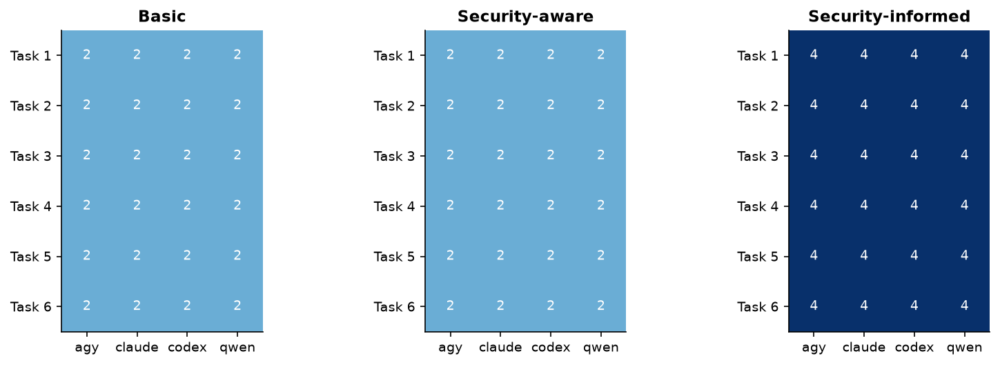

Figure 1: Completed reviews per task and generator · All conditions, all
reviews

<a href="#fig-completeness" class="quarto-xref">Figure 1</a> shows a
uniform review count across every task–generator combination within each
condition. Security-informed contains more completed reviews per
combination because it includes the external reviews as well as
self-review.

## Paired difference in findings per review, overall and by generator

Table 3: Paired difference in findings per review, overall and by
generator · Basic and Security-aware, matched pairs, self-review

| scope | pairs | Basic mean | Security-aware mean | mean delta | median delta | fewer | more | ties | CI low | CI high |
|:---|---:|---:|---:|---:|---:|---:|---:|---:|---:|---:|
| all | 48 | 6.25 | 6.56 | 0.31 | 0.0 | 18 | 23 | 7 | -0.29 | 0.94 |
| agy | 12 | 6.33 | 7.42 | 1.08 | 1.0 | 2 | 9 | 1 | 0.17 | 1.92 |
| claude | 12 | 5.5 | 5.75 | 0.25 | 0.0 | 3 | 5 | 4 | -0.83 | 1.25 |
| codex | 12 | 4.33 | 3.58 | -0.75 | -1.0 | 7 | 4 | 1 | -1.67 | 0.17 |
| qwen | 12 | 8.83 | 9.5 | 0.67 | -0.5 | 6 | 5 | 1 | -1.0 | 2.33 |

Across all 48 matched pairs in
<a href="#tbl-paired" class="quarto-xref">Table 3</a>, Security-aware
averaged 6.56 findings against 6.25 for Basic, a mean delta of 0.31 with
a CI from -0.29 to 0.94; 23 pairs had more findings, 18 fewer, and 7
tied. The generator-level mean deltas were 1.08 for agy, 0.25 for
claude, -0.75 for codex, and 0.67 for qwen.

## Paired difference in findings per review by generator

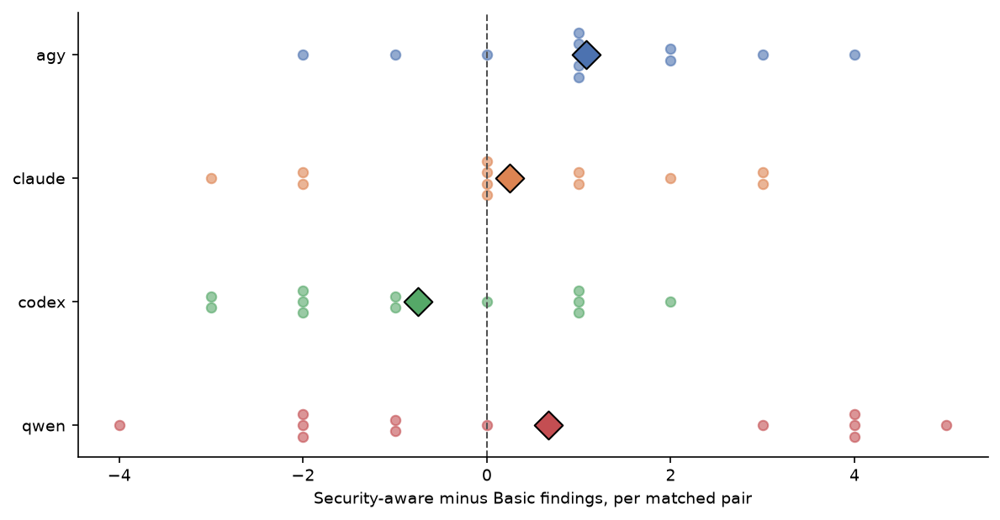

Figure 2: Paired difference in findings per review by generator · Basic
and Security-aware, matched pairs, self-review

<a href="#fig-paired" class="quarto-xref">Figure 2</a> shows mixed
pair-level changes for every generator rather than a uniform
Security-aware shift. The mean marker is to the right of no change for
agy, claude, and qwen, and to the left for codex, with observations on
both sides for each generator.

## Findings per review, median and High/Critical share

Table 4: Findings per review, median and High/Critical share · All
conditions, self-review

| condition | self-reviews | findings | findings per review | median | High/Critical % |
|:---|---:|---:|---:|---:|---:|
| Basic | 48 | 300 | 6.25 | 6.0 | 16.67 |
| Security-aware | 48 | 315 | 6.56 | 7.0 | 17.78 |
| Security-informed | 24 | 139 | 5.79 | 7.0 | 14.39 |

In <a href="#tbl-conditions" class="quarto-xref">Table 4</a>,
Security-aware had the highest findings per self-review at 6.56,
followed by Basic at 6.25 and Security-informed at 5.79. Their medians
were 7.0, 6.0, and 7.0 respectively, while the High/Critical shares were
17.78%, 16.67%, and 14.39%.

## Findings per review

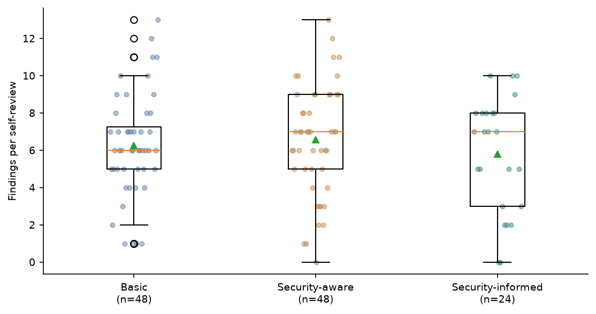

Figure 3: Findings per review · All conditions, self-review

<a href="#fig-distribution" class="quarto-xref">Figure 3</a> shows
substantial overlap in findings per self-review across the three
conditions. Security-aware has the broadest upper range, while the
Security-informed distribution extends down to reviews with no findings.

## Findings per review by generator

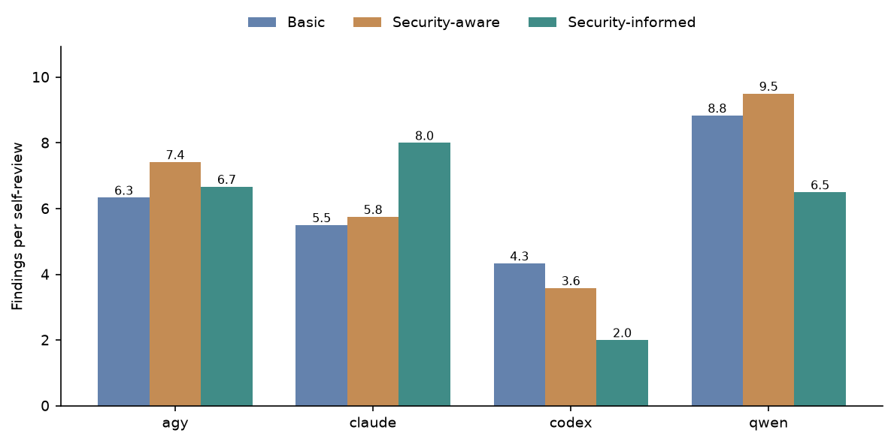

Figure 4: Findings per review by generator · All conditions, self-review

<a href="#fig-generator" class="quarto-xref">Figure 4</a> shows that the
condition pattern differs by generator: Security-aware is highest for
agy and qwen, Security-informed is highest for claude, and Basic is
highest for codex. Codex is lowest under Security-informed, whereas
claude is highest in that condition.

## Findings per review by task

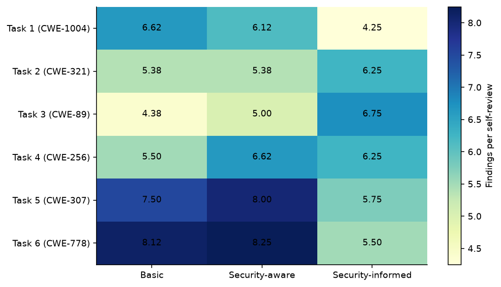

Figure 5: Findings per review by task · All conditions, self-review

<a href="#fig-task" class="quarto-xref">Figure 5</a> shows different
condition patterns across tasks: Security-informed is highest for the
tasks anchored to CWE-321 and CWE-89, while Basic or Security-aware is
higher for the other tasks. The tasks anchored to CWE-307 and CWE-778
have the highest rates under Basic and Security-aware, but both fall
under Security-informed.

## Severity of findings

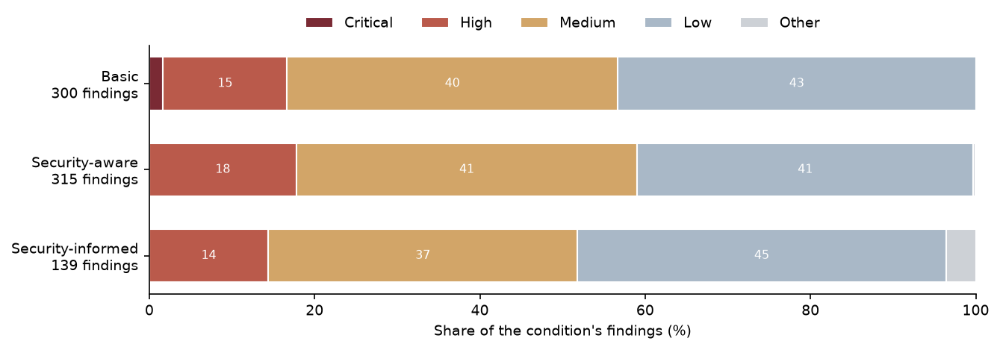

Figure 6: Severity of findings · All conditions, self-review

Low and Medium findings make up most reviewer-reported findings in every
condition in <a href="#fig-severity" class="quarto-xref">Figure 6</a>.
Security-aware has the largest High share, while Security-informed has
the largest Low share and is the only condition with a visible Other
segment.

## Reviews naming the task’s anchor CWE

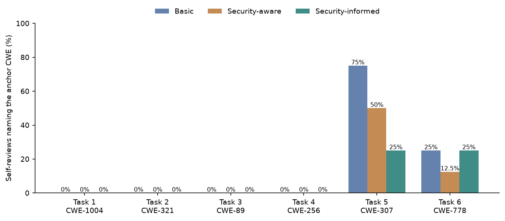

Figure 7: Reviews naming the task’s anchor CWE · All conditions,
self-review

<a href="#fig-anchor" class="quarto-xref">Figure 7</a> shows no
self-reviews naming the anchor CWE for the tasks anchored to CWE-1004,
CWE-321, CWE-89, or CWE-256. Anchor naming appears only for the CWE-307
and CWE-778 tasks, and is most prominent for CWE-307 under Basic.

## The 14 most-reported CWEs

Table 5: The 14 most-reported CWEs · All findings

| rank | CWE | title | findings | cumulative % |
|---:|:---|:---|---:|---:|
| 1 | CWE-307 | Improper Restriction of Excessive Authentication Attempts | 90 | 7.4 |
| 2 | CWE-400 | Uncontrolled Resource Consumption | 82 | 14.1 |
| 3 | CWE-916 | Use of Password Hash With Insufficient Computational Effort | 58 | 18.9 |
| 4 | CWE-316 | Cleartext Storage of Sensitive Information in Memory | 52 | 23.2 |
| 5 | CWE-732 | Incorrect Permission Assignment for Critical Resource | 50 | 27.3 |
| 6 | CWE-521 | Weak Password Requirements | 49 | 31.3 |
| 7 | CWE-770 | Allocation of Resources Without Limits or Throttling | 40 | 34.6 |
| 8 | CWE-367 | Time-of-check Time-of-use (TOCTOU) Race Condition | 35 | 37.5 |
| 9 | CWE-362 | Concurrent Execution using Shared Resource with Improper Synchronization (‘Race Condition’) | 32 | 40.1 |
| 10 | CWE-208 | Observable Timing Discrepancy | 31 | 42.6 |
| 11 | CWE-532 | Insertion of Sensitive Information into Log File | 31 | 45.2 |
| 12 | CWE-798 | Use of Hard-coded Credentials | 31 | 47.7 |
| 13 | CWE-204 | Observable Response Discrepancy | 26 | 49.9 |
| 14 | CWE-209 | Generation of Error Message Containing Sensitive Information | 25 | 51.9 |

CWE-307 led <a href="#tbl-top-cwes" class="quarto-xref">Table 5</a> with
90 reviewer-reported findings (7.4%), followed by CWE-400 with 82;
CWE-916 was third with 58. The 14 listed CWEs accounted cumulatively for
51.9% of all findings.

## Findings per review by CWE

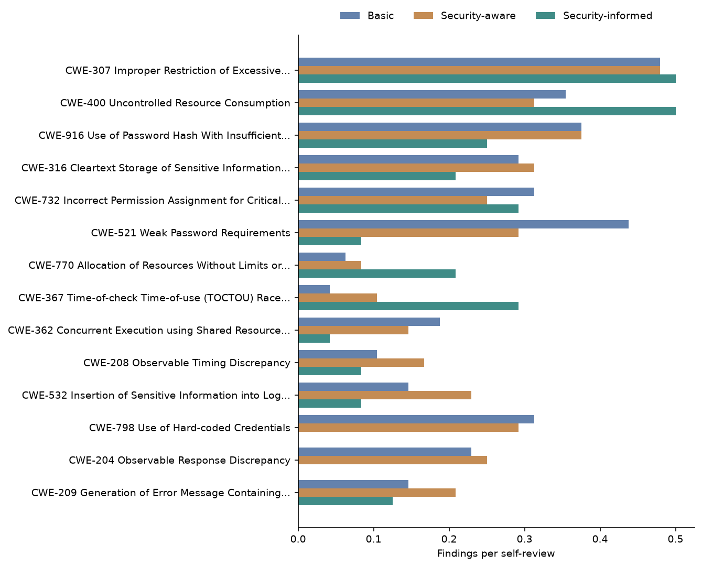

Figure 8: Findings per review by CWE · All conditions, self-review

<a href="#fig-cwe-rates" class="quarto-xref">Figure 8</a> shows CWE-307
and CWE-400 among the highest-rate labels across conditions.
Security-informed is relatively higher for CWE-400, CWE-770, and
CWE-367, but lower for CWE-521, CWE-362, CWE-532, CWE-798, CWE-204, and
CWE-209.

## Findings per review by CWE, per condition

Table 6: Findings per review by CWE, per condition · All conditions,
self-review

| category | Basic | Security-aware | Security-informed |
|:---|---:|---:|---:|
| CWE-307 Improper Restriction of Excessive… | 0.48 | 0.48 | 0.5 |
| CWE-400 Uncontrolled Resource Consumption | 0.35 | 0.31 | 0.5 |
| CWE-916 Use of Password Hash With Insufficient… | 0.38 | 0.38 | 0.25 |
| CWE-316 Cleartext Storage of Sensitive Information… | 0.29 | 0.31 | 0.21 |
| CWE-732 Incorrect Permission Assignment for Critical… | 0.31 | 0.25 | 0.29 |
| CWE-521 Weak Password Requirements | 0.44 | 0.29 | 0.08 |
| CWE-770 Allocation of Resources Without Limits or… | 0.06 | 0.08 | 0.21 |
| CWE-367 Time-of-check Time-of-use (TOCTOU) Race… | 0.04 | 0.1 | 0.29 |
| CWE-362 Concurrent Execution using Shared Resource… | 0.19 | 0.15 | 0.04 |
| CWE-208 Observable Timing Discrepancy | 0.1 | 0.17 | 0.08 |
| CWE-532 Insertion of Sensitive Information into Log… | 0.15 | 0.23 | 0.08 |
| CWE-798 Use of Hard-coded Credentials | 0.31 | 0.29 | 0.0 |
| CWE-204 Observable Response Discrepancy | 0.23 | 0.25 | 0.0 |
| CWE-209 Generation of Error Message Containing… | 0.15 | 0.21 | 0.12 |
| Other | 2.77 | 3.06 | 3.12 |

In <a href="#tbl-cwe-rates" class="quarto-xref">Table 6</a>, CWE-307
rates are similar across conditions at 0.48, 0.48, and 0.5, while
CWE-400 rises to 0.5 in Security-informed from 0.35 in Basic and 0.31 in
Security-aware. Security-informed reports 0.0 for CWE-798 and CWE-204,
and its Other rate of 3.12 is the table’s largest Other value.

## Findings per review by OWASP category

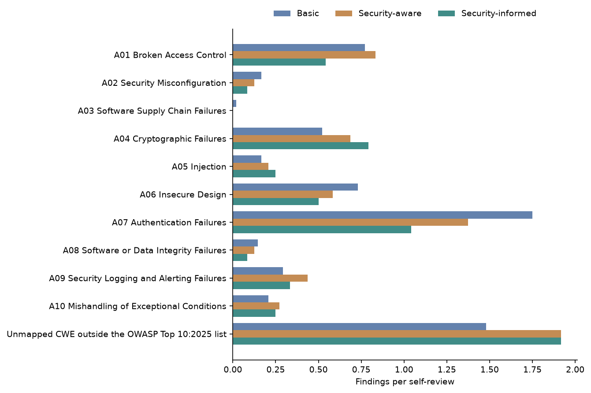

Figure 9: Findings per review by OWASP category · All conditions,
self-review

<a href="#fig-owasp-rates" class="quarto-xref">Figure 9</a> shows A07 as
the highest mapped OWASP-category rate in all three conditions, while
the unmapped group is higher still for Security-aware and
Security-informed. A04 and A05 rise from Basic to Security-informed,
whereas A01, A02, A06, A07, and A08 decline.

## Findings per review by OWASP category, per condition

Table 7: Findings per review by OWASP category, per condition · All
conditions, self-review

| category | Basic | Security-aware | Security-informed |
|:---|---:|---:|---:|
| A01 Broken Access Control | 0.77 | 0.83 | 0.54 |
| A02 Security Misconfiguration | 0.17 | 0.12 | 0.08 |
| A03 Software Supply Chain Failures | 0.02 | 0.0 | 0.0 |
| A04 Cryptographic Failures | 0.52 | 0.69 | 0.79 |
| A05 Injection | 0.17 | 0.21 | 0.25 |
| A06 Insecure Design | 0.73 | 0.58 | 0.5 |
| A07 Authentication Failures | 1.75 | 1.38 | 1.04 |
| A08 Software or Data Integrity Failures | 0.15 | 0.12 | 0.08 |
| A09 Security Logging and Alerting Failures | 0.29 | 0.44 | 0.33 |
| A10 Mishandling of Exceptional Conditions | 0.21 | 0.27 | 0.25 |
| Unmapped CWE outside the OWASP Top 10:2025 list | 1.48 | 1.92 | 1.92 |

In <a href="#tbl-owasp-rates" class="quarto-xref">Table 7</a>, A07 is
the highest mapped category in every condition, at 1.75 for Basic, 1.38
for Security-aware, and 1.04 for Security-informed. The unmapped rate is
1.48, 1.92, and 1.92 respectively; A04 rises from 0.52 to 0.69 to 0.79,
while A03 is 0.02, 0.0, and 0.0.

## CWE make-up of findings

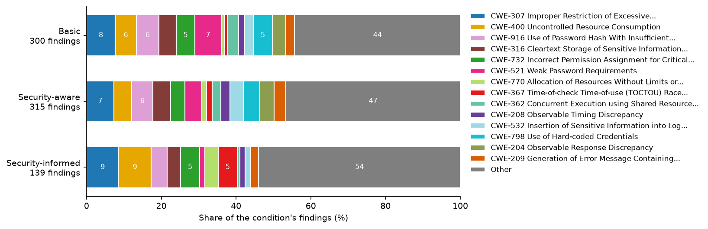

Figure 10: CWE make-up of findings · All conditions, self-review

<a href="#fig-cwe-mix" class="quarto-xref">Figure 10</a> shows that
Other CWEs form the largest share in every condition and are most
prominent in Security-informed. Among the named labels,
Security-informed has visibly larger shares for CWE-400 and CWE-367 and
a smaller share for CWE-521 than the other conditions.

## OWASP category make-up of findings

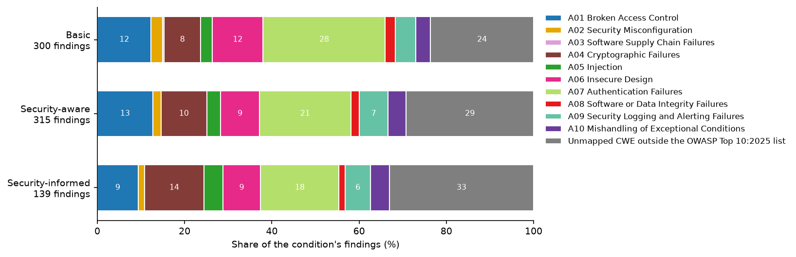

Figure 11: OWASP category make-up of findings · All conditions,
self-review

The unmapped group is the largest segment under Security-aware and
Security-informed in
<a href="#fig-owasp-mix" class="quarto-xref">Figure 11</a>, while A07 is
the largest mapped segment in every condition. Security-informed shows a
larger A04 share and smaller A01, A06, and A07 shares than Basic.

## CWE make-up of findings by generator

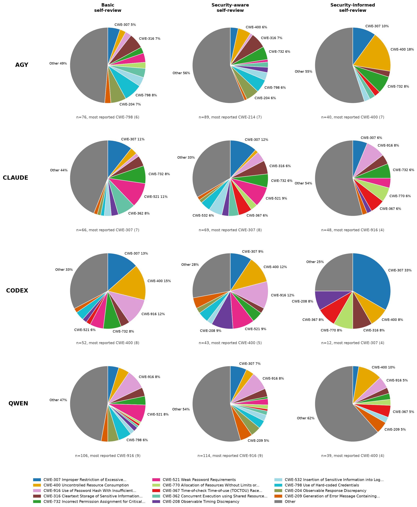

Figure 12: CWE make-up of findings by generator · All conditions,
self-review

<a href="#fig-cwe-pies" class="quarto-xref">Figure 12</a> shows
substantial variation in CWE composition by generator and condition.
Other CWEs dominate most panels, while codex’s Security-informed panel
is concentrated in CWE-307 and agy’s corresponding panel gives greater
prominence to CWE-400.

## OWASP category make-up of findings by generator

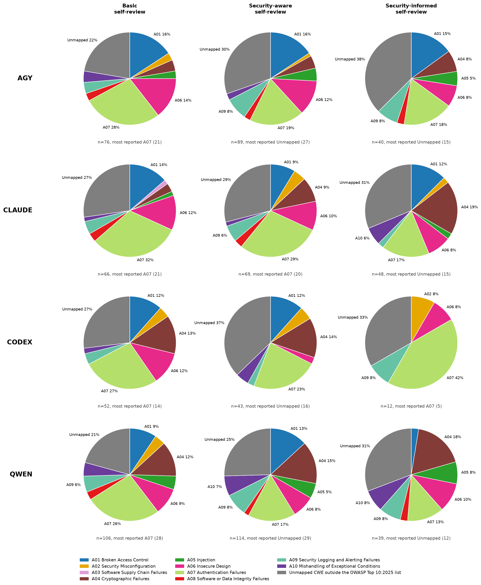

Figure 13: OWASP category make-up of findings by generator · All
conditions, self-review

<a href="#fig-owasp-pies" class="quarto-xref">Figure 13</a> shows that
A07 or the unmapped group is the largest segment in most
generator–condition panels. A07 is especially prominent for codex under
Security-informed, while the unmapped share is largest for agy and qwen
in that condition.

## Findings per review by Security-informed rule

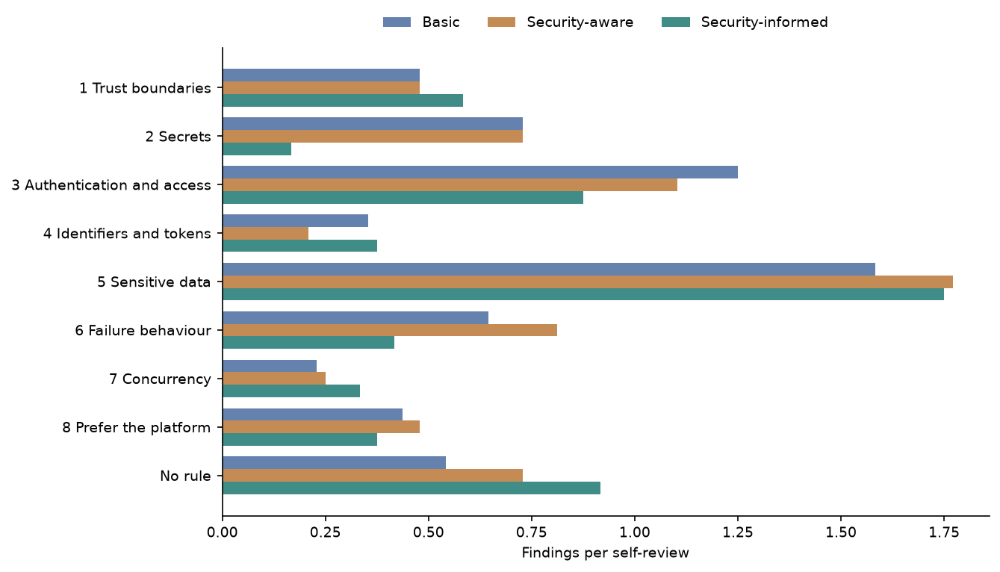

Figure 14: Findings per review by Security-informed rule · All
conditions, self-review

<a href="#fig-rule-rates" class="quarto-xref">Figure 14</a> shows
Sensitive data as the highest-rate rule group under all conditions.
Security-informed is lower for Secrets, Authentication and access, and
Failure behaviour, but higher for Trust boundaries, Concurrency, and No
rule.

## Findings per review by Security-informed rule, per condition

Table 8: Findings per review by Security-informed rule, per condition ·
All conditions, self-review

| category                    | Basic | Security-aware | Security-informed |
|:----------------------------|------:|---------------:|------------------:|
| 1 Trust boundaries          |  0.48 |           0.48 |              0.58 |
| 2 Secrets                   |  0.73 |           0.73 |              0.17 |
| 3 Authentication and access |  1.25 |            1.1 |              0.88 |
| 4 Identifiers and tokens    |  0.35 |           0.21 |              0.38 |
| 5 Sensitive data            |  1.58 |           1.77 |              1.75 |
| 6 Failure behaviour         |  0.65 |           0.81 |              0.42 |
| 7 Concurrency               |  0.23 |           0.25 |              0.33 |
| 8 Prefer the platform       |  0.44 |           0.48 |              0.38 |
| No rule                     |  0.54 |           0.73 |              0.92 |

Sensitive data has the highest rate in every condition in
<a href="#tbl-rule-rates" class="quarto-xref">Table 8</a>: 1.58 for
Basic, 1.77 for Security-aware, and 1.75 for Security-informed.
Security-informed is lowest for Secrets at 0.17 and highest for No rule
at 0.92; Authentication and access declines from 1.25 to 1.1 to 0.88.

## Rule make-up of findings

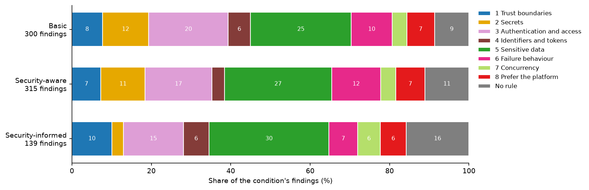

Figure 15: Rule make-up of findings · All conditions, self-review

Sensitive data is the largest rule share in every condition in
<a href="#fig-rule-mix" class="quarto-xref">Figure 15</a>.
Security-informed assigns visibly smaller shares to Secrets and Failure
behaviour and larger shares to Trust boundaries, Concurrency, and No
rule than the other conditions.

## Findings per review by reviewer and generator

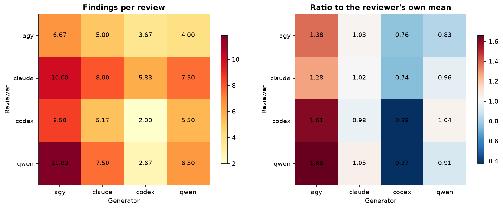

Figure 16: Findings per review by reviewer and generator ·
Security-informed, all four reviewers

<a href="#fig-matrix" class="quarto-xref">Figure 16</a> shows that all
reviewers report more findings on agy-generated programs than on
codex-generated programs. Relative to each reviewer’s own mean, agy is
above average for every reviewer, while codex is below average for every
reviewer and especially low in codex and qwen reviews.

## Reviewer volume, severity and own-code contrast

Table 9: Reviewer volume, severity and own-code contrast ·
Security-informed, all four reviewers

| reviewer | reviews | findings per review | High/Critical % | distinct CWEs | own code | other code | other minus own |
|:---|---:|---:|---:|---:|---:|---:|---:|
| agy | 24 | 4.83 | 29.31 | 50 | 6.67 | 4.22 | -2.44 |
| claude | 24 | 7.83 | 7.98 | 60 | 8.0 | 7.78 | -0.22 |
| codex | 24 | 5.29 | 14.96 | 46 | 2.0 | 6.39 | 4.39 |
| qwen | 24 | 7.12 | 15.79 | 68 | 6.5 | 7.33 | 0.83 |

Claude reported the most findings per review in
<a href="#tbl-behaviour" class="quarto-xref">Table 9</a> at 7.83, while
agy reported the highest High/Critical share at 29.31% and qwen the most
distinct CWEs at 68. Codex showed the largest own-code contrast: 2.0
findings per review on own code versus 6.39 on other code, an
other-minus-own difference of 4.39.

## Reviewer volume against severity, and own code against other generators’ code

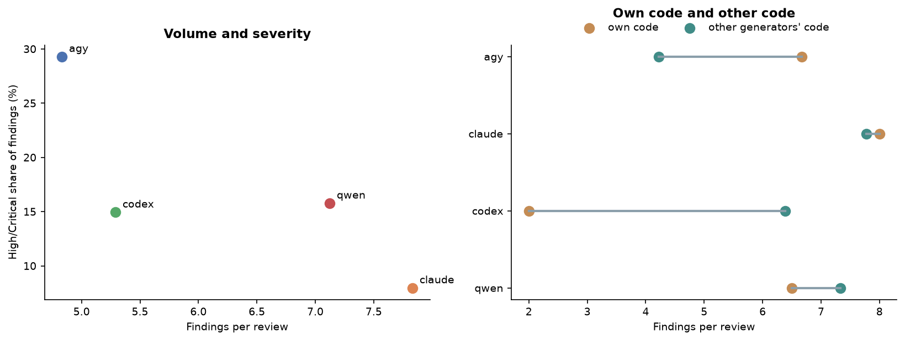

Figure 17: Reviewer volume against severity, and own code against other
generators’ code · Security-informed, all four reviewers

<a href="#fig-behaviour" class="quarto-xref">Figure 17</a> separates
reviewer volume from severity: claude has the highest finding volume but
the lowest High/Critical share, while agy shows the reverse pattern. Agy
and claude report fewer findings on other generators’ code than on their
own, whereas codex and qwen report more.

## Severity of findings by reviewer

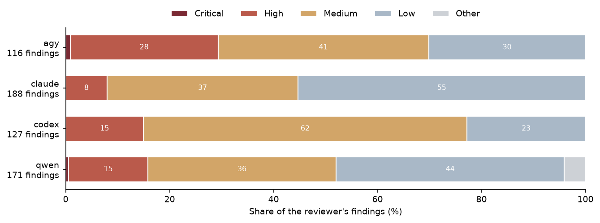

Figure 18: Severity of findings by reviewer · Security-informed, all
four reviewers

<a href="#fig-severity-reviewer" class="quarto-xref">Figure 18</a> shows
distinct severity mixes by reviewer. Agy has the largest High share,
codex is dominated by Medium findings, claude has the largest Low share,
and qwen alone has a clearly visible Other segment.

## Reviewers naming the same CWE, and the same OWASP category, on a program

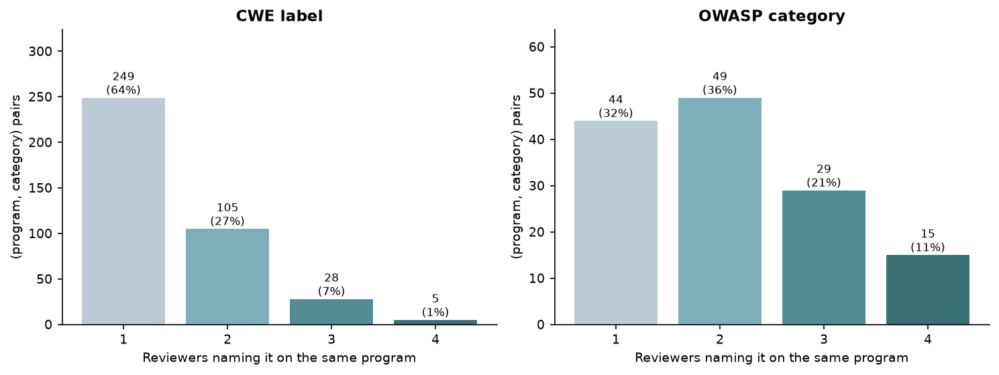

Figure 19: Reviewers naming the same CWE, and the same OWASP category,
on a program · Security-informed, all four reviewers

<a href="#fig-agreement" class="quarto-xref">Figure 19</a> shows that
CWE labels are most often named by only one reviewer on a program, with
progressively fewer pairs shared by additional reviewers. OWASP-category
agreement is broader: naming by two reviewers is most common, and three-
and four-reviewer agreement is more visible than for CWE labels.

## Share of (program, category) pairs named by 1, 2, 3 or 4 reviewers

Table 10: Share of (program, category) pairs named by 1, 2, 3 or 4
reviewers · Security-informed, all four reviewers

| level          | pairs | named by 1 % | named by 2 % | named by 3 % | named by 4 % |
|:---------------|------:|-------------:|-------------:|-------------:|-------------:|
| CWE label      |   387 |         64.3 |         27.1 |          7.2 |          1.3 |
| OWASP category |   137 |         32.1 |         35.8 |         21.2 |         10.9 |

At the CWE-label level in
<a href="#tbl-agreement" class="quarto-xref">Table 10</a>, 64.3% of 387
pairs were named by 1 reviewer, 27.1% by 2, 7.2% by 3, and 1.3% by all
4. For the 137 OWASP-category pairs, the corresponding shares were
32.1%, 35.8%, 21.2%, and 10.9%.

## Mean Jaccard overlap of each reviewer pair’s labels on the same program

Table 11: Mean Jaccard overlap of each reviewer pair’s labels on the
same program · Security-informed, all four reviewers

| reviewer pair  | CWE Jaccard | OWASP Jaccard |
|:---------------|------------:|--------------:|
| agy / claude   |        0.12 |          0.29 |
| agy / codex    |        0.12 |          0.26 |
| agy / qwen     |         0.1 |          0.31 |
| claude / codex |        0.22 |          0.31 |
| claude / qwen  |        0.19 |          0.54 |
| codex / qwen   |        0.13 |          0.34 |

<a href="#tbl-jaccard" class="quarto-xref">Table 11</a> reports low mean
pairwise overlap at the CWE level, ranging from 0.1 for agy / qwen to
0.22 for claude / codex. OWASP overlap is higher for every pair, led by
claude / qwen at 0.54 and lowest for agy / codex at 0.26.

## CWE make-up of findings by generator

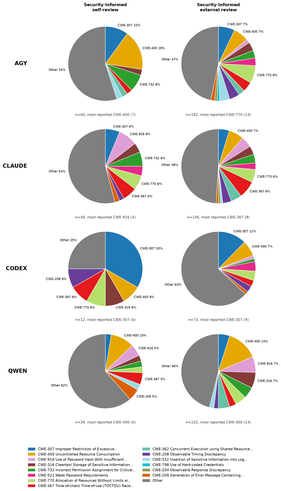

Figure 20: CWE make-up of findings by generator · Security-informed,
self-review and external review

<a href="#fig-cwe-pies-2" class="quarto-xref">Figure 20</a> shows that
external-review CWE mixes are generally more dispersed than self-review
mixes. The largest named external-review label differs by generator:
CWE-770 for agy, CWE-367 for claude, CWE-307 for codex, and CWE-400 for
qwen.

## OWASP category make-up of findings by generator

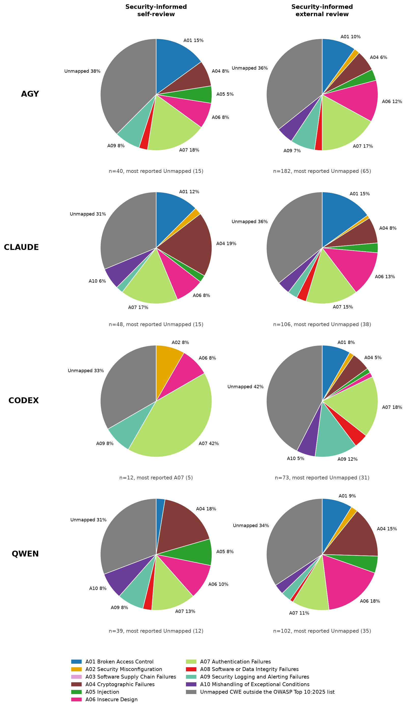

Figure 21: OWASP category make-up of findings by generator ·
Security-informed, self-review and external review

In <a href="#fig-owasp-pies-2" class="quarto-xref">Figure 21</a>, the
unmapped group is the largest segment for every generator’s external
reviews. Compared with self-review, external reviews are less
concentrated in A07 for codex and show a larger A06 share for agy and
qwen.

## Findings per review by CWE and task

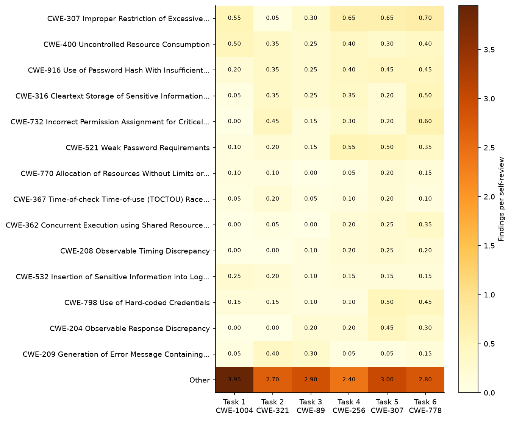

Figure 22: Findings per review by CWE and task · All conditions,
self-review

<a href="#fig-cwe-task" class="quarto-xref">Figure 22</a> shows that the
Other group is the largest rate for every task. Among named CWEs,
CWE-307 is strongest on the tasks anchored to CWE-1004, CWE-256,
CWE-307, and CWE-778, while CWE-732 reaches its highest rates on the
tasks anchored to CWE-321 and CWE-778.

## Findings per review by OWASP category and task

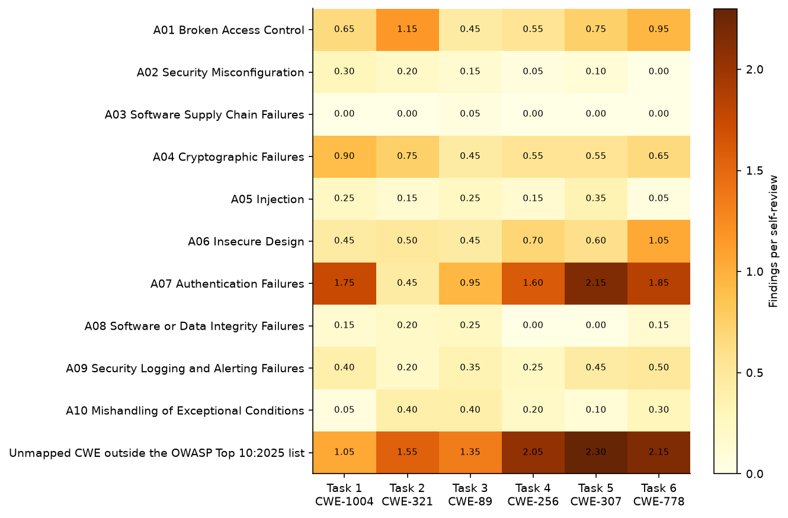

Figure 23: Findings per review by OWASP category and task · All
conditions, self-review

<a href="#fig-owasp-task" class="quarto-xref">Figure 23</a> shows the
unmapped group as the highest rate for every task except the task
anchored to CWE-1004, where A07 is highest. A07 is also the leading
mapped category for most tasks, while A01 leads among mapped categories
for the task anchored to CWE-321.

## Data checks

Table 12: Data checks · All reviews

| check                               | value |
|:------------------------------------|------:|
| CSV rows                            |  1224 |
| Recorded findings                   |  1217 |
| Reviews                             |   192 |
| Reviews with no findings            |     7 |
| Generated programs                  |   120 |
| Rows missing reviewer or generator  |     0 |
| Programs read by all 4 reviewers    |    24 |
| Duplicate CSV rows                  |     0 |
| Findings with no CWE                |     0 |
| Findings with non-standard severity |     8 |
| Repeated sec_id within one review   |     0 |

<a href="#tbl-checks" class="quarto-xref">Table 12</a> records 1224 CSV
rows, 1217 reviewer-reported findings, 192 reviews, and 120 generated
programs, with 7 reviews reporting no findings. It also shows 0 rows
missing reviewer or generator, 0 duplicate rows, 0 findings with no CWE,
8 findings with non-standard severity, and 0 repeated sec_id values
within a review.

## About this report

Every table and figure is computed from `findings.csv` when the report
is rendered. The text was written by an AI from the rendered tables and
figures. All counts are reviewer-reported findings, not confirmed
vulnerabilities.
