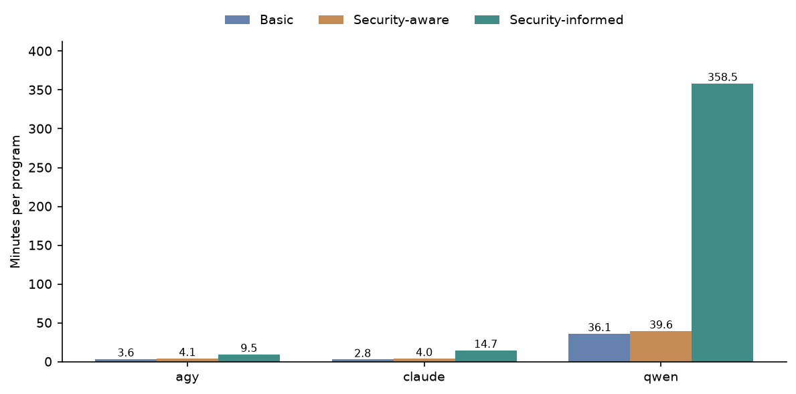
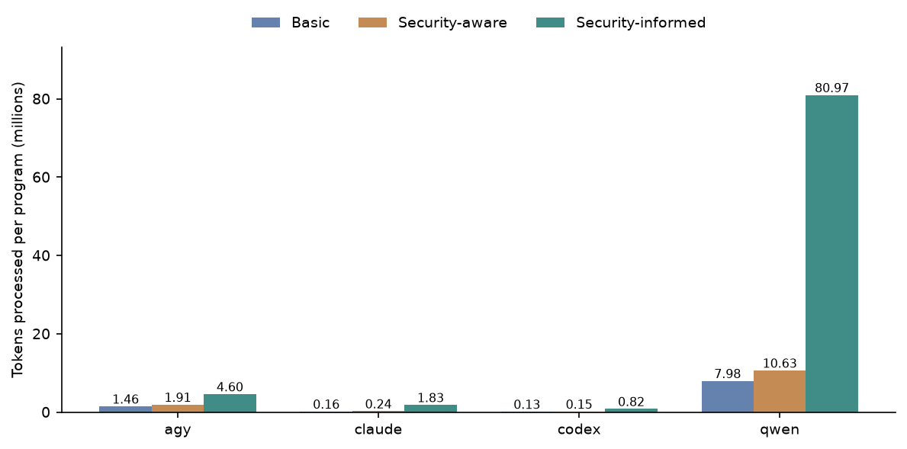
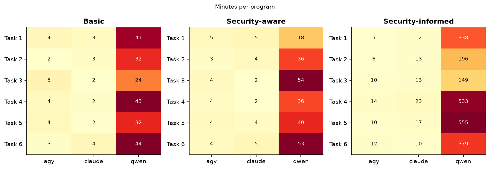
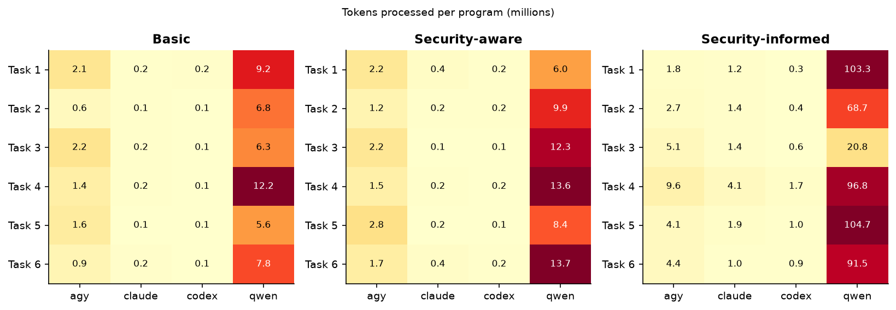
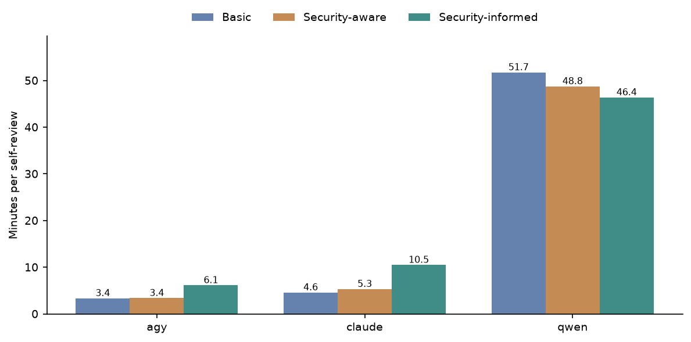
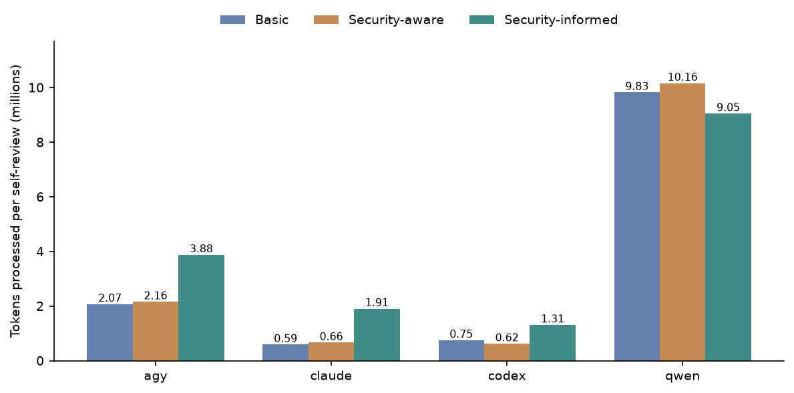
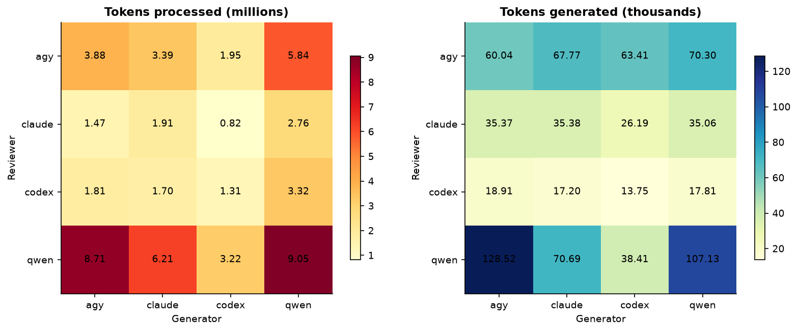
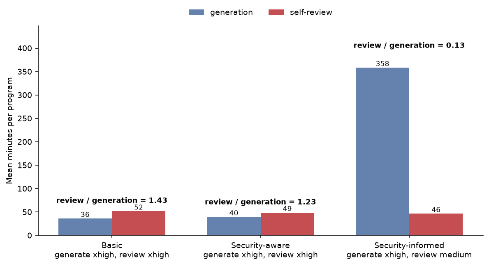
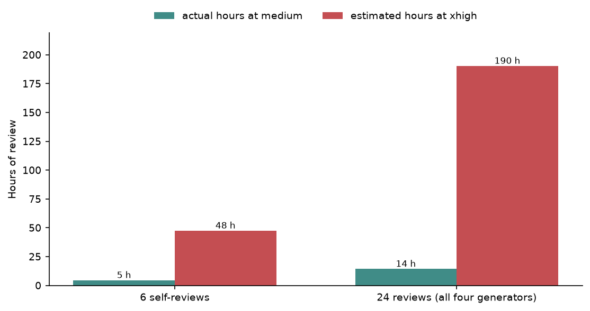

# Run cost data report

- [Summary](#summary)
- [What was measured](#what-was-measured)
  - [Source of the numbers](#source-of-the-numbers)
  - [Two token measures, one rule for every
    assistant](#two-token-measures-one-rule-for-every-assistant)
  - [Gaps in the data](#gaps-in-the-data)
- [How the runs finished](#sec-run-completion)
- [Overall cost per assistant](#sec-run-overall)
- [Generation](#sec-run-generation)
- [Review](#sec-run-review)
- [Claude at maximum effort in the pilot](#sec-run-sonnet)
- [Qwen review effort](#sec-run-qwen)
- [Reading these numbers](#sec-run-reading)

<!-- The report template. The cyber workflow renders it as-is (markdown, blank TEXT
     placeholders) for the writer AI to read, then copies it to final_report_run_cost.qmd with
     html/docx output, the writer fills the placeholders in that copy, and the copy is rendered. -->

## Summary

- Qwen had the largest generation totals, at 50.98 hours and 709.11
  million tokens processed across 30 runs; its review totals were 34.53
  hours and 402.96 million tokens across 48 runs.
- Antigravity had 29 successful generation runs and one error; seven of
  its generation runs returned empty replies. Every Claude, Codex and
  Qwen generation and review run was successful and returned a non-empty
  reply.
- Codex generation processed 8.28 million tokens in total, the lowest
  generation total in
  <a href="#tbl-run-headline" class="quarto-xref">Table 3</a>, but Codex
  run time was not reported.
- The recovered Claude Sonnet 5 max-effort pilot took 30.24 minutes and
  processed 1.24 million tokens, compared with 4.38 minutes and 0.24
  million tokens for Claude Opus 5 medium on the same task.
- For Qwen, Basic and Security-aware self-reviews took 51.75 and 48.76
  minutes per program, while Security-informed self-review at medium
  effort took 46.38 minutes versus 358.46 minutes for generation at
  xhigh effort.

> **Reader’s rule:** time and tokens describe the coding assistant as
> configured (model, effort setting, scaffolding and hardware), not the
> model alone. Codex records no run time, so it is absent from every
> time figure.

## What was measured

### Source of the numbers

This report summarizes the completion status and CLI-reported time,
token and turn data for generation and security-review runs. Generation
costs are grouped by the assistant that wrote the program, while review
costs are grouped by the assistant that reviewed it.

- A **generation run** is one assistant writing one program. Its cost
  belongs to the generator.
- A **review run** is one reviewer reading one program. Its cost belongs
  to the reviewer.

### Two token measures, one rule for every assistant

The assistants expose input and cache activity differently, so the table
distinguishes each tool’s own token total from the common
tokens-processed measure used in this report. The common measure
includes generated output and all reported input activity, including
cache creation or cached reads where those are reported separately.

| Assistant | What “input” counts | Cached tokens | Tool’s own total | Tokens processed, as used here |
|:---|:---|:---|:---|:---|
| Antigravity | input not read from cache | reported separately | input + output | input + cached read + output |
| Claude Code | input not read from or written to cache | reported separately, plus cache creation | input + output | input + cache creation + cached read + output |
| Codex | all input, cached included | already inside input | input + output | input + output |
| Qwen Code | the whole prompt, re-sent on every request | not reported | input + output | input + output |

How each assistant reports tokens, and the measure this report derives
from them

### Gaps in the data

Codex run time was not reported, so it is absent from the time summaries
and figures. Antigravity had one generation run with ERROR status and
seven generation runs with empty replies, including that error run; the
other assistants show neither issue.

## How the runs finished

Table 1: Run status and empty replies by assistant · All generation and
review runs

| assistant | stage      | runs | status SUCCESS | status ERROR | empty reply |
|:----------|:-----------|-----:|---------------:|-------------:|------------:|
| agy       | generation |   30 |             29 |            1 |           7 |
| agy       | review     |   48 |             48 |            0 |           0 |
| claude    | generation |   30 |             30 |            0 |           0 |
| claude    | review     |   48 |             48 |            0 |           0 |
| codex     | generation |   30 |             30 |            0 |           0 |
| codex     | review     |   48 |             48 |            0 |           0 |
| qwen      | generation |   30 |             30 |            0 |           0 |
| qwen      | review     |   48 |             48 |            0 |           0 |

In <a href="#tbl-run-completion" class="quarto-xref">Table 1</a>,
Antigravity completed 29 of 30 generation runs successfully, with one
ERROR and seven empty replies, while all 48 of its review runs succeeded
without empty replies. Claude, Codex and Qwen each show 30 successful
generation runs and 48 successful review runs, with no errors or empty
replies.

Table 2: Runs that ended in ERROR or returned no reply · All generation
and review runs

| run                           | stage      | status  | empty reply | minutes |
|:------------------------------|:-----------|:--------|:------------|--------:|
| agy/post_research/1/security/ | generation | ERROR   | yes         |     5.0 |
| agy/ruth/3/basic/             | generation | SUCCESS | yes         |     4.9 |
| agy/ruth/5/basic/             | generation | SUCCESS | yes         |     5.0 |
| agy/ruth/5/security/          | generation | SUCCESS | yes         |     4.9 |
| agy/sallie/1/security/        | generation | SUCCESS | yes         |     4.8 |
| agy/sallie/3/basic/           | generation | SUCCESS | yes         |     4.9 |
| agy/sallie/3/security/        | generation | SUCCESS | yes         |     4.9 |

All seven entries in
<a href="#tbl-run-problems" class="quarto-xref">Table 2</a> are
Antigravity generation runs: `agy/post_research/1/security/` ended in
ERROR after 5.0 minutes, and the other six had SUCCESS status but empty
replies. The reported times shown are 4.8, 4.9 and 5.0 minutes.

## Overall cost per assistant

Table 3: Time and tokens per assistant · All generation runs (by
generator) and all review runs (by reviewer); Codex records no time

| assistant | stage | runs | total hours | mean minutes per run | total tokens processed (M) | mean tokens processed per run (M) | mean tokens generated per run (k) |
|:---|:---|---:|---:|---:|---:|---:|---:|
| agy | generation | 30 | 2.47 | 4.95 | 68.09 | 2.27 | 45.8 |
| agy | review | 48 | 3.73 | 4.66 | 141.09 | 2.94 | 51.45 |
| claude | generation | 30 | 2.84 | 5.68 | 15.81 | 0.53 | 27.11 |
| claude | review | 48 | 5.3 | 6.63 | 56.78 | 1.18 | 28.25 |
| codex | generation | 30 |  |  | 8.28 | 0.28 | 8.13 |
| codex | review | 48 |  |  | 65.42 | 1.36 | 13.28 |
| qwen | generation | 30 | 50.98 | 101.96 | 709.11 | 23.64 | 233.91 |
| qwen | review | 48 | 34.53 | 43.17 | 402.96 | 8.39 | 98.67 |

Qwen has the largest totals in
<a href="#tbl-run-headline" class="quarto-xref">Table 3</a>: generation
used 50.98 hours and 709.11 million tokens processed, while review used
34.53 hours and 402.96 million tokens processed. Codex generation
processed 8.28 million tokens and Codex review processed 65.42 million,
but time was not reported for either stage. Antigravity and Claude
generation averaged 4.95 and 5.68 minutes per run, and their reviews
averaged 4.66 and 6.63 minutes per run.

## Generation

Figure 1: Mean minutes per program by generator and condition · All
generation runs; Codex records no time

<a href="#fig-run-gen-time" class="quarto-xref">Figure 1</a> shows Qwen
taking substantially longer than Antigravity and Claude in every
condition, with the separation becoming especially pronounced for
Security-informed generation. Generation time rises across the three
conditions for all timed assistants, while Codex is absent because its
time was not reported.

Figure 2: Mean tokens processed per program by generator and condition ·
All generation runs

<a href="#fig-run-gen-tokens" class="quarto-xref">Figure 2</a> shows
Qwen processing the most tokens per program in every condition and Codex
the fewest. For each generator, the Security-informed bar is higher than
its Basic and Security-aware bars.

Figure 3: Mean minutes per program by task and generator · All
generation runs; Codex records no time

Across the task panels in
<a href="#fig-run-gen-task-time" class="quarto-xref">Figure 3</a>, Qwen
takes longer than the other timed generators for every task and
condition. Its Security-informed times vary widely across tasks and are
much higher than its Basic and Security-aware times, while Antigravity
and Claude remain comparatively clustered.

Figure 4: Mean tokens processed per program by task and generator · All
generation runs

<a href="#fig-run-gen-task-tokens" class="quarto-xref">Figure 4</a>
shows Qwen processing the most tokens for every task-condition
combination, with its largest values concentrated in the
Security-informed panel. Antigravity, Claude and Codex also generally
process more tokens in Security-informed tasks than in the other
conditions, though their task-to-task patterns differ.

## Review

Figure 5: Mean minutes per self-review by reviewer and condition · All
conditions, self-review; Codex records no time

In <a href="#fig-run-review-time" class="quarto-xref">Figure 5</a>, Qwen
self-reviews take far longer than Antigravity or Claude self-reviews in
all three conditions. Qwen’s bars decline from Basic to
Security-informed, whereas Antigravity and Claude have their highest
bars in Security-informed; Codex is absent because its time was not
reported.

Figure 6: Mean tokens processed per self-review by reviewer and
condition · All conditions, self-review

<a href="#fig-run-review-tokens" class="quarto-xref">Figure 6</a> shows
Qwen processing the most tokens per self-review in every condition,
followed by Antigravity. Security-informed is the highest condition for
Antigravity, Claude and Codex, while Qwen’s Security-informed bar is
lower than its Basic and Security-aware bars.

Figure 7: Mean tokens per review, reviewer × generator ·
Security-informed, all four reviewers

In the processed-token panel of
<a href="#fig-run-review-matrix" class="quarto-xref">Figure 7</a>, Qwen
is the highest-volume reviewer for every generator, and every reviewer
processes the most tokens when reviewing Qwen-generated programs. The
generated-token panel is less uniform: Antigravity’s output is fairly
even across generators, while Qwen’s output varies markedly by
generator.

## Claude at maximum effort in the pilot

This section compares the recovered Claude Sonnet 5 max-effort pilot
with Claude Opus 5 at medium effort for the same Basic generation task.
It also places the pilot beside the Opus mean across all 12 Basic runs,
covering minutes, output and thinking tokens, processed tokens and
turns.

Table 4: Claude Sonnet 5 at max effort (recovered pilot run) against
Claude Opus 5 at medium · Task 1 Basic, generation; Opus mean over its
12 Basic runs

| measure | Sonnet 5 max, pilot | Opus 5 medium, same task | Sonnet / Opus | Opus 5 medium, mean of 12 Basic runs |
|:---|---:|---:|---:|---:|
| minutes | 30.24 | 4.38 | 6.91 | 2.81 |
| output tokens | 166076.0 | 23639.0 | 7.03 | 13680.0 |
| thinking tokens | 139895.0 | 7475.0 | 18.72 | 3234.25 |
| thinking share of output % | 84.24 | 31.62 | 2.66 | 23.64 |
| tokens processed (M) | 1.24 | 0.24 | 5.12 | 0.16 |
| turns | 21.0 | 12.0 | 1.75 | 9.08 |

In <a href="#tbl-run-sonnet" class="quarto-xref">Table 4</a>, the Sonnet
5 max pilot took 30.24 minutes, produced 166076.0 output tokens,
processed 1.24 million tokens and used 21.0 turns; the same-task Opus 5
medium run used 4.38 minutes, 23639.0 output tokens, 0.24 million
processed tokens and 12.0 turns. The corresponding Sonnet / Opus ratios
were 6.91, 7.03, 5.12 and 1.75. Sonnet reported 139895.0 thinking tokens
and an 84.24% thinking share, compared with 7475.0 and 31.62% for the
same-task Opus run.

## Qwen review effort

This section separates Qwen generation time from self-review time by
condition and records the effort setting used for each stage. It then
compares actual Security-informed review hours at medium effort with the
report’s xhigh estimates for six self-reviews and for the full 24-review
panel.

Figure 8: Qwen mean minutes to generate a program and to self-review it,
with effort settings · All conditions, Qwen generation and self-review

<a href="#fig-run-qwen-effort" class="quarto-xref">Figure 8</a> shows
self-review taking slightly longer than generation for Basic and
Security-aware programs when both stages use xhigh effort. For
Security-informed programs, generation at xhigh is much longer than
self-review at medium.

Table 5: Qwen generation and self-review time per program, with effort
settings · All conditions, Qwen generation and self-review

| condition | programs | generation effort | review effort | generation minutes | self-review minutes | review / generation |
|:---|---:|:---|:---|---:|---:|---:|
| Basic | 12 | xhigh | xhigh | 36.11 | 51.75 | 1.43 |
| Security-aware | 12 | xhigh | xhigh | 39.56 | 48.76 | 1.23 |
| Security-informed | 6 | xhigh | medium | 358.46 | 46.38 | 0.13 |

In <a href="#tbl-run-qwen-effort" class="quarto-xref">Table 5</a>, Qwen
generation and self-review averaged 36.11 and 51.75 minutes for Basic
programs and 39.56 and 48.76 minutes for Security-aware programs,
yielding review / generation values of 1.43 and 1.23. For
Security-informed programs, xhigh generation averaged 358.46 minutes and
medium self-review averaged 46.38 minutes, with a review / generation
value of 0.13.

Table 6: Qwen panel review hours at medium, and estimated at xhigh ·
Security-informed, Qwen as reviewer

| Qwen panel reviews | actual hours at medium | estimated hours at xhigh |
|:---|---:|---:|
| 6 self-reviews | 4.6 | 47.6 |
| 24 reviews (all four generators) | 14.4 | 190.5 |

<a href="#tbl-run-qwen-estimate" class="quarto-xref">Table 6</a> reports
4.6 actual hours at medium and 47.6 estimated hours at xhigh for six
Qwen self-reviews. For all 24 panel reviews, it reports 14.4 actual
hours at medium and 190.5 estimated hours at xhigh.

Figure 9: Qwen panel review hours: actual at medium and estimated at
xhigh · Security-informed, Qwen as reviewer

<a href="#fig-run-qwen" class="quarto-xref">Figure 9</a> shows the
estimated xhigh review time well above the actual medium-effort time for
both the six self-reviews and the 24-review panel. The full panel is
higher than the self-review subset under both effort presentations.

## Reading these numbers

The tables report each CLI’s recorded time, tokens and turns, with
missing values left unreported. Time comparisons therefore exclude
Codex, while token comparisons use the common processed-token definition
shown earlier. Condition, task, stage, reviewer and generator breakdowns
are presented separately so the displayed totals and means retain their
stated scope.
